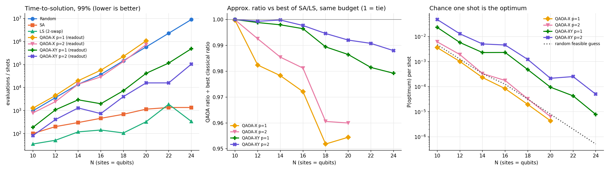

# FastShelter — Flood-Shelter Siting with QAOA (Qiskit)

Choose which **K of N** candidate sites to open as flood shelters so that the most people are served, at the lowest cost, without putting shelters that can flood together in the same zone. The problem is written as a QUBO and solved with **QAOA in Qiskit**. Every result is checked against an **exact brute-force optimum** and against classical baselines (greedy, simulated annealing, 2-swap local search, random).


## Problem

| | |
|---|---|
| **Users** | District disaster-management offices, city planners, relief NGOs |
| **Decision variables** | `x_i = 1` if site *i* is opened, else 0 |
| **Objective (minimise)** | `−w_cov·Σ p_i x_i + w_cov·Σ o_ij x_i x_j + w_cost·Σ c_i x_i + w_risk·Σ r_ij x_i x_j` |
| **Constraint** | `Σ x_i = K` (penalty `λ(Σx − K)²` for standard QAOA, λ = 40) |
| **Test instance** | N = 10, K = 4, seed 7 — 1,024 bit-strings, 210 valid |

- `p_i` people served, `c_i` opening cost
- `o_ij = 0.5·min(p_i, p_j)·exp(−d_ij/0.25)`: people counted twice when two shelters are close
- `r_ij = 30` if sites *i* and *j* share a flood zone

## Quantum method

- **Mapping:** qubit *i* = site *i*; `x = (1 − Z)/2` gives Z and ZZ terms (`SparsePauliOp`).
- **QAOA, depth p = 1, 2:** cost layer `PauliEvolutionGate`, trained with COBYLA.
- **Two mixers:**
  - **X-mixer + penalty** (standard): `H` start, `RX(2β)` mixer, searches all 2^N states.
  - **XY-mixer** (constraint-preserving): `StatePreparation` of the weight-K (Dicke) state, `XX+YY` ring mixer. It never leaves the valid answers.
- **Simulation:** noiseless statevector simulation on a CPU. The fast simulator used for training is checked against the Qiskit circuits (max difference ≈ 1e-15). No real IBM hardware was used.


## How to run

```bash
pip install -r requirements.txt
python fastshelter_code           

```

For the scaling study, open `fastshelter_code.ipynb` in Google Colab (File → Upload notebook) and choose **Runtime → Run all**. All instances use fixed seeds, so results repeat exactly.

## Results

**Small instance (N = 10, K = 4, seed 7).** Exact optimum: sites `[0, 2, 3, 6]`, value −216.5. Greedy finds it too.

| Method | P(optimum) per shot | Random | P(valid) | Optimum in top 10? |
|---|---|---|---|---|
| X-mixer, p = 1 | 0.0037 | 0.0010 | 0.53 | yes (top answer) |
| X-mixer, p = 2 | 0.0050 | 0.0010 | 0.78 | yes |
| XY-mixer, p = 1 | 0.0031 | 0.0048 | 1.00 | no |
| XY-mixer, p = 2 | 0.0390 | 0.0048 | 1.00 | yes |

**Scaling (N = 10–24, 3 instances each).** Tries needed to find the optimum with 99% confidence (median):

| N | Random | Simulated annealing | Local search | XY-QAOA p=2 (readout) | XY-QAOA p=2 (incl. training) |
|---|---|---|---|---|---|
| 10 | 965 | 100 | 35 | 81 | 1,173,071 |
| 16 | 36,876 | 459 | 142 | 734 | 600,734 |
| 20 | 580,111 | 1,147 | 325 | 15,855 | 415,855 |
| 24 | 9,031,915 | 1,354 | 336 | 103,772 | 503,772 |



- XY-QAOA beats random guessing, and its lead grows with N (10× at N = 10, 98× at N = 24).
- Simulated annealing and local search are still far faster, and that gap widens with N.
- With the same budget of 1,000 tries at N = 24, local search finds the optimum 100% of the time, simulated annealing 93%, XY-QAOA 4.8% and random guessing 0.05%.

## Limitations

- Training cost (80,000–1,200,000 shots) dominates; QAOA shows **no practical advantage** at these sizes.
- The X-mixer wastes 32–62% of its shots on invalid answers and is no better than random from N = 18.
- The XY-mixer always gives valid answers but needs a deeper circuit on real hardware.
- Noiseless simulation only; cost doubles with each qubit. Synthetic data; the objective only counts overlap between pairs of shelters, so it does not capture true coverage exactly.
- 3 instances per size, so single-N numbers are noisy.
